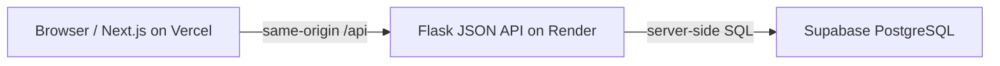

# TutorTrack

Private GCSE maths tutoring dashboard for one tutor. It stores students, lessons, topic observations, saved resource links and monthly feedback in PostgreSQL. Gemini and Slack are **planned**, not part of this release.

## Architecture



Next.js owns the interface and proxies `/api/*` to Flask. Flask owns login, validation, record ownership, reporting and database transactions. The session cookie is HttpOnly, SameSite=Lax and Secure when `FLASK_DEBUG=0`; unsafe writes require a CSRF token. The browser never sees `DATABASE_URL` or supplies an authoritative tutor ID. Flask serves JSON only, so `/api/health` is the API check; the UI is on port 3000 locally.

Lesson dates and start times are Europe/London civil values. Audit timestamps are UTC. Small ordered string lists (goals, topics and one-off links) use JSONB. Observations, saved resources, lesson attachments and monthly reports have separate tables.

## Local setup

Prerequisites: Node.js with npm, Python 3.13, a development Supabase PostgreSQL project and a recent pnpm. The repo pins `pnpm@12.3.4`; if `pnpm` is not on PATH, run commands with `npx --yes pnpm@12.3.4`.

1. Clone the repository. From its root, run `npx --yes pnpm@12.3.4 install --frozen-lockfile`.
2. Copy `.env.example` to `.env.local`. For local use, keep `FLASK_API_ORIGIN=http://127.0.0.1:5000`.
3. Copy `backend/.env.example` to `backend/.env`. Fill in the Supabase PostgreSQL URI as `DATABASE_URL` and generate a random `FLASK_SECRET_KEY` using the command in the example. Keep `FLASK_DEBUG=1` for localhost. Do not commit or share either secret.
4. In one terminal:

```bash
cd backend
python3 -m venv .venv
source .venv/bin/activate
pip install -r requirements-dev.txt
python migrate.py
python setup_tutor.py
python app.py
```

`setup_tutor.py` prompts locally for a tutor email and password; it stores only a password hash. Use `--reset` only to deliberately replace the password.

5. In another terminal from the project root, run `npx --yes pnpm@12.3.4 dev`. Open [http://localhost:3000](http://localhost:3000) and sign in. [http://127.0.0.1:5000/api/health](http://127.0.0.1:5000/api/health) should return `{"ok":true}`; an anonymous `/api/students` request should return 401.

## Verification and migrations

```bash
cd backend
source .venv/bin/activate
pytest -q
```

With `DATABASE_URL` set, database tests create and drop an isolated schema. Do not run tests against a database containing sensitive production records; use the development project. Without a database connection, integration tests skip. For WP6, the development Supabase run passed 33 tests.

```bash
npx --yes pnpm@12.3.4 lint
npx --yes pnpm@12.3.4 typecheck
npx --yes pnpm@12.3.4 build
```

`backend/schema.sql` is the additive schema; `python migrate.py` applies it. Apply it once for a fresh database and again after schema updates. It uses `CREATE TABLE/INDEX IF NOT EXISTS` and additive alterations, but review changes and take a backup before applying any future destructive migration. Never run `setup_tutor.py --reset` in an unattended deploy.

## Deployment preparation

Deployment needs a separate Flask host because Vercel builds only the Next.js frontend. Provision the database and API before merging this release: a merge to `main` automatically deploys Vercel. Render's Free web service can sleep after inactivity, so warm it before an interview or choose a paid plan deliberately. See [Render's Flask guide](https://render.com/docs/deploy-flask) and [Free plan limits](https://render.com/docs/free). Creating a Render service starts a production deployment; perform these steps only after explicit approval.

1. Create a dedicated production Supabase project. In a separate clean checkout for the production setup, create an ignored `backend/.env` with its `DATABASE_URL`, a stable `FLASK_SECRET_KEY`, `TUTOR_ID=tut_local` and `FLASK_DEBUG=0`. Check the Supabase project reference carefully. From that checkout's `backend/`, create the venv, install `requirements.txt`, run `python migrate.py`. In the production project's Supabase SQL Editor, apply `backend/production_access.sql` to revoke `anon`/`authenticated` table privileges and enable RLS with no public policies; Flask connects directly as the database owner. Then run `python setup_tutor.py` interactively **once**. The access script is deliberately separate so it is not applied to an existing development database by routine migrations. Remove that temporary checkout after verification. On Render Free, pre-deploy migration commands are unavailable; do not add `migrate.py` to the service start command.
2. In Render, create a **Web Service** from this repo's reviewed `wp7-deployment-interview` branch, with root directory `backend`, Python runtime (the `backend/.python-version` file selects Python 3.13), Frankfurt region, Free plan if its idle delay is acceptable, build command `pip install -r requirements.txt`, start command `gunicorn --bind 0.0.0.0:$PORT --workers 2 app:app`, health check path `/api/health`, and automatic deploys **off**. Add the same production `DATABASE_URL` (the Supabase **session pooler** URI with SSL), `FLASK_SECRET_KEY`, `FLASK_DEBUG=0` and `TUTOR_ID=tut_local` privately in Render. Do not put secrets in GitHub, a PR, or chat.
3. Confirm `https://<your-api>.onrender.com/api/health` returns `{"ok":true}`. Add Vercel's Production environment variable `FLASK_API_ORIGIN=https://<your-api>.onrender.com` (no trailing `/api`); this affects the next deployment, not the existing one. Then, with explicit approval, merge this PR into `main`. Vercel will build the frontend with that API origin. In Render's service settings, change its linked branch to `main` and manually deploy the reviewed merge commit so both hosts use the release code. See [Vercel environment variables](https://vercel.com/docs/environment-variables).
4. Open the Vercel production URL in a fresh browser session. Check that sign-in and the complete fictional demo below work after refresh, sign-out blocks data, and no real student details appear in screenshots. Verify HTTPS, cookie behaviour and both deployed commits before calling the release complete.

Environment variables:

| Location | Name | Purpose |
| --- | --- | --- |
| Flask / Render | `DATABASE_URL` | Server-only Supabase PostgreSQL URI with `sslmode=require`; secret. |
| Flask / Render | `FLASK_SECRET_KEY` | Stable random secret, at least 32 characters; secret. Changing it invalidates sessions. |
| Flask / Render | `FLASK_DEBUG` | `0` in production for Secure cookies and disabled debugger; `1` locally only. |
| Flask / Render | `TUTOR_ID` | First account ID for setup (default `tut_local`); session controls API ownership. |
| Flask / local | `PORT` | Local Flask port (default 5000); Render sets this automatically. |
| Next.js / Vercel | `FLASK_API_ORIGIN` | Server-only HTTPS origin for the Flask API; never a browser `NEXT_PUBLIC_*` secret. |

## Fictional demonstration (3–5 minutes)

1. Sign in as the account you created. Add **Alex Taylor**, Year 11, Higher, with an algebra goal and `Linear equations` as the next topic. Refresh to show persistence.
2. Schedule Alex a lesson. Mark it completed with topics, a strength, a difficulty, homework and a next plan. Add a saved algebra resource and attach it to the lesson. Show the real dashboard totals.
3. Record two dated observations of the same topic, `needs support` and then `developing`, with distinct evidence and next actions. Both stay in history.
4. Select Alex and a month with completed lessons in Reports. Edit, save, refresh, then copy or download the report. Point out that missing evidence is disclosed, not invented.
5. Archive and restore Alex, then sign out and check that a direct student page/API request cannot reveal records.

Capture screenshots from this fictional-data flow for your portfolio only after the live deployment has passed; no production screenshots are claimed yet.

## Known limits

One tutor account is configured interactively; there are no parent/student accounts, automated emails, file uploads, PDF reports, AI generation or Slack reminders. The free Render service can sleep. The API health endpoint tests the process, not database availability. There is no hosted production verification until the deployment steps above are completed.

See [docs/INTERVIEW.md](docs/INTERVIEW.md) for a concise architecture explanation, a real bug and fix, and truthful CV phrasing.
